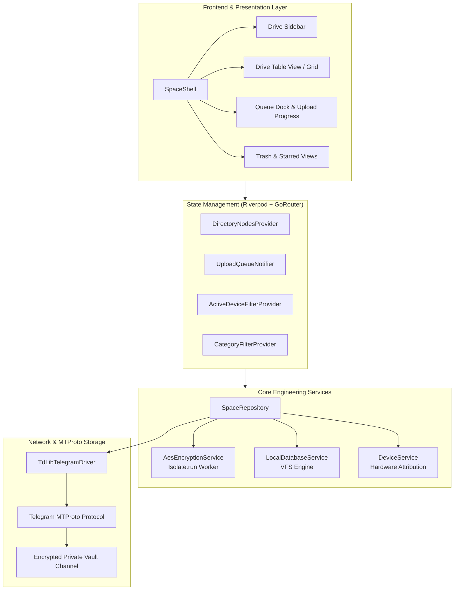

# 🌌 SpaceHERE

<div align="center">


-2CA5E0?logo=telegram&logoColor=white)


**A high-performance, zero-knowledge decentralized cloud drive with Google Drive-grade UX, cosmic minimalism aesthetics, and unlimited storage backed by Telegram MTProto.**

[Architecture](#-system-architecture) • [Features](#-key-features) • [Getting Started](#-getting-started) • [Security Model](#-zero-knowledge-security-model) • [Testing & CI/CD](#-testing--cicd)

</div>

---

## 📖 Overview

**SpaceHERE** transforms Telegram's global MTProto infrastructure into an infinite, private, zero-knowledge decentralized file storage system. Built with Flutter and Riverpod, SpaceHERE marries the familiar, battle-tested layout paradigms of **Google Drive** with a sleek **space-themed dark aesthetic**, client-side cryptographic isolation, and multiplatform hardware device attribution.

All files are encrypted client-side using **AES-256-GCM** before leaving your machine. Telegram servers only store opaque, scrambled binary chunks and never see filenames, folder structures, MIME types, or unencrypted data.

---

## ⚡ Key Features

- **🛡️ Zero-Knowledge Client-Side Encryption**:
  - Keys derived using **PBKDF2-HMAC-SHA256** (100,000 iterations) with cryptographic 16-byte salts.
  - Every file and chunk is encrypted with authenticated **AES-256-GCM** using unique 12-byte initialization vectors (IVs).
- **🚀 Isolate-Offloaded Cryptography**:
  - Heavy encryption/decryption of large files (e.g., 300MB+) runs in dedicated background isolates (`Isolate.run()`), keeping the Flutter UI running at a silky-smooth 60/120 FPS without dropped frames.
- **🖥️ Google Drive-Grade UX + Space Theme**:
  - **Persistent 240px Sidebar**: One-click navigation between *Home*, *My Drive*, *Starred*, and *Trash*.
  - **Dual View Modes**: Seamless toggle between a responsive **Drive Table View** (with checkboxes, MIME badges, device origin, size, and date modified) and an interactive **Grid Card View**.
  - **Dynamic Trash & Recycle Bin**: Complete with Google Drive 30-day banner and one-click "Empty Trash Now" purging.
  - **Starred Quick Access**: Star important files and access them instantly across all folders.
- **📱 Multiplatform Hardware Attribution**:
  - Origin tracking automatically tags every folder, upload, and duplicated node with the originating device (e.g. `Ubuntu Desktop` vs `OnePlus CPH2613`).
  - Dedicated **COMPUTERS & DEVICES** sidebar section with real-time hardware filtering.
- **🌐 Native Telegram MTProto (TDLib) Integration**:
  - Direct integration with native Telegram Database Library (TDLib).
  - 50MB chunking with zero-copy memory views (`Uint8List.sublistView`).
  - Automated `FLOOD_WAIT` exponential backoff and network reconnection resilience.
  - Redundant sync state discovery through pinned messages and channel history fallbacks.
- **📁 High-Performance Virtual File System (VFS)**:
  - Local SQLite / VFS engine with nested folder hierarchies, breadcrumb navigation, search, and Last-Write-Wins (LWW) conflict resolution.

---

## 🏗️ System Architecture



---

## 📂 Repository Structure

```
SpaceHERE/
├── .github/workflows/      # Automated CI/CD pipeline
│   └── ci.yml              # GitHub Actions lint, test, and Linux/Android build
├── android/                # Native Android platform project
├── linux/                  # Native Linux desktop platform project
├── windows/                # Native Windows desktop platform project
├── web/                    # Web runner
├── lib/
│   ├── app.dart            # MaterialApp entry point and theme injection
│   ├── main.dart           # Application bootstrap and TDLib binding
│   ├── core/
│   │   ├── config/         # Telegram API config and constants
│   │   ├── exceptions/     # Typed error parser (FLOOD_WAIT, auth, network)
│   │   ├── logging/        # Centralized logger service
│   │   ├── routing/        # Declarative GoRouter configuration
│   │   └── theme/          # Cosmic Minimalism dark theme palette
│   ├── features/
│   │   ├── auth/           # Two-layer authentication (Passphrase + Telegram OTP)
│   │   ├── dashboard/      # Google Drive shell, sidebar, and status dock
│   │   ├── settings/       # Vault settings and encryption verification
│   │   └── storage/        # Folder view, Drive Table View, and Grid View
│   ├── models/             # SpaceNode, QueueState, SyncState data models
│   └── services/
│       ├── crypto/         # AES-256-GCM + PBKDF2 isolate-powered encryption
│       ├── database/       # Local VFS database with device attribution
│       ├── device/         # Hardware platform resolver (Ubuntu / OnePlus / etc.)
│       ├── network/        # TDLib Telegram MTProto driver & interface
│       └── repository/     # Unified SpaceRepository & Riverpod providers
├── test/                   # Comprehensive unit and widget test suite (34 tests)
├── tool/                   # Production build and automation scripts
│   ├── build_android.sh    # Optimized arm64 Android APK builder
│   ├── build_linux.sh      # Linux desktop bundle compiler
│   └── run_tests.sh        # Static analysis, formatting, and coverage suite
├── pubspec.yaml            # Project dependencies and asset definitions
└── README.md               # Documentation and architecture guide
```

---

## 🔒 Zero-Knowledge Security Model

| Security Dimension | Implementation Standard |
| :--- | :--- |
| **Symmetric Cipher** | **AES-256-GCM** (Galois/Counter Mode) with 128-bit authentication tag |
| **Key Derivation** | **PBKDF2-HMAC-SHA256** (100,000 iterations) with 16-byte cryptographically secure random salt |
| **Nonce / IV** | 12-byte secure random IV generated per encrypted chunk/file |
| **Key Storage** | Hardware-backed secure storage via `flutter_secure_storage` (`libsecret` on Linux, KeyStore on Android) |
| **Threat Model** | Telegram servers, network intermediaries, and third parties cannot access filenames, metadata, or file content |

---

## 🚀 Getting Started

### Prerequisites

#### Linux Desktop (Ubuntu / Debian)
```bash
sudo apt update
sudo apt install -y clang cmake ninja-build pkg-config libsecret-1-dev lld
```

#### Android
- Android SDK 34+
- NDK (for TDLib native binaries)
- Connected Android device with USB debugging enabled (or ADB over Wi-Fi)

---

### Configuration

You can configure Telegram MTProto credentials either via environment variables or compile-time `--dart-define` flags:

```bash
flutter run -d linux \
  --dart-define=TELEGRAM_API_ID=YOUR_API_ID \
  --dart-define=TELEGRAM_API_HASH=YOUR_API_HASH
```

---

### Run Application

#### Linux Desktop
```bash
flutter run -d linux
```

#### Android Device
```bash
flutter run -d android
```

#### Web (Preview)
```bash
flutter run -d chrome
```

---

## 🧪 Testing & CI/CD

SpaceHERE includes a comprehensive automated test suite covering VFS tree traversal, cryptographic round-trips, isolate streaming, device attribution, and `FLOOD_WAIT` recovery backoff.

### Run All Checks & Tests
```bash
./tool/run_tests.sh
```

Or execute directly with Flutter:
```bash
# Code format check
dart format --set-exit-if-changed lib test

# Static analysis (0 issues enforced)
flutter analyze

# Run unit and widget tests
flutter test --coverage
```

### Build Production Releases
```bash
# Build Linux Release Bundle
./tool/build_linux.sh

# Build Optimized Android APK
./tool/build_android.sh
```

---

## 🤝 Contributing

Contributions are welcome! Please ensure that:
1. All changes pass `flutter analyze` with 0 issues.
2. All unit and widget tests pass (`flutter test`).
3. Commits follow standard conventional commit guidelines.

---

## 📄 License

This project is licensed under the MIT License - see the [LICENSE](LICENSE) file for details.
